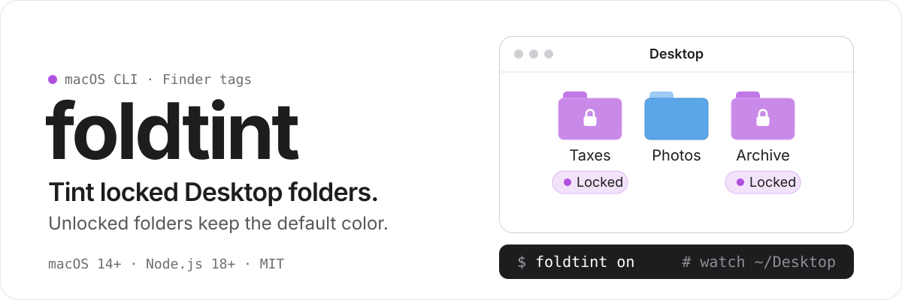
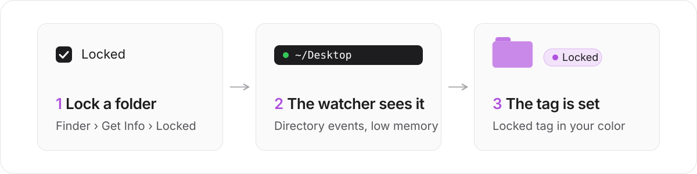
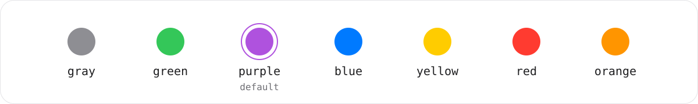

<p align="center">
  
</p>

<p align="center">
  <a href="https://www.npmjs.com/package/foldtint"></a>
  <a href="https://www.apple.com/macos/"></a>
  <a href="https://nodejs.org/"></a>
  <a href="LICENSE"></a>
  <a href="https://x.com/mdafanulh"></a>
</p>

<p align="center">
  <a href="https://foldtint.site"><b>Website</b></a> ·
  <a href="#quick-start">Quick start</a> ·
  <a href="#commands">Commands</a> ·
  <a href="#limits">Limits</a>
</p>

foldtint applies color to locked folders on the Desktop. This differentiates them from unlocked folders on macOS. Unlocked folders keep the default macOS folder color.

When the watcher is on, the color changes happen automatically. The watcher continues after a shutdown or a restart.

## Quick start

```sh
npm install -g foldtint
foldtint on
```

Then lock a folder on the Desktop: **Finder › Get Info › Locked**. foldtint adds the `Locked` tag in purple. An unlock removes the tag.

**Requirements:** macOS 14 or later, Node.js 18 or later, npm.

The install procedure puts a native binary on the computer. The tool does not need network access after install. The tool does not need root access.

The `on` command installs a LaunchAgent. The LaunchAgent uses the installed `foldtint` binary. Keep the npm global install in place while the watcher runs.

## How it works

<p align="center">
  
</p>

- A locked folder is a folder with the Finder **Locked** checkbox. That flag is the user immutable flag.
- When a folder is locked, foldtint adds the Finder tag `Locked` with the configured color. Other tags stay.
- When a folder is unlocked, foldtint removes only the `Locked` tag. Other tags stay.
- The watcher uses directory events on the Desktop. The watcher does not use per-file events. Memory use stays low.

## Colors

<p align="center">
  
</p>

```sh
foldtint color          # show the current color
foldtint color purple   # set the color for all locked Desktop folders
```

Valid names: `gray`, `green`, `purple`, `blue`, `yellow`, `red`, `orange`. These names are Finder tag colors. Hex values are not valid.

The `color` command writes the configuration. Then the command scans the Desktop.

## Commands

| Command | Action |
| --- | --- |
| `foldtint on` | Start the watcher. The command installs a LaunchAgent. |
| `foldtint off` | Stop the watcher. Current tints stay. Folders stay locked. |
| `foldtint status` | Show the color, the Desktop path, the watcher state, and the folder counts. |
| `foldtint color [name]` | Show or set the color. |
| `foldtint scan` | Apply or remove the `Locked` tag on top-level Desktop folders now. Use it after a repair. You do not need it when the watcher is on. |
| `foldtint daemon` | Run the watcher in the current process. The `on` command starts this process through the LaunchAgent. Do not run it by hand unless you do a test. |
| `foldtint uninstall` | Remove foldtint data. See [Uninstall](#uninstall). |
| `foldtint --help` | Show help. |

## Limits

- The tool works on macOS only.
- The tool watches `~/Desktop` only, and changes top-level Desktop folders only. The tool does not change nested folders.
- The tool does not change files, aliases, apps, or packages.
- The tool does not follow symbolic links.
- The tool does not use `/`, `/System`, or `/Applications`.
- The tool does not set custom icons.
- The tool does not use hex colors.

## Uninstall

1. Remove foldtint data:

   ```sh
   foldtint uninstall
   ```

   The command stops the watcher and removes the LaunchAgent. The command removes the `Locked` tag from top-level Desktop folders and deletes the configuration file. The command does not unlock folders.

2. Remove the npm package:

   ```sh
   npm uninstall -g foldtint
   ```

## License

MIT. See [`LICENSE`](LICENSE). To contribute, see [`CONTRIBUTING.md`](CONTRIBUTING.md). To report a security problem, see [`SECURITY.md`](SECURITY.md).
